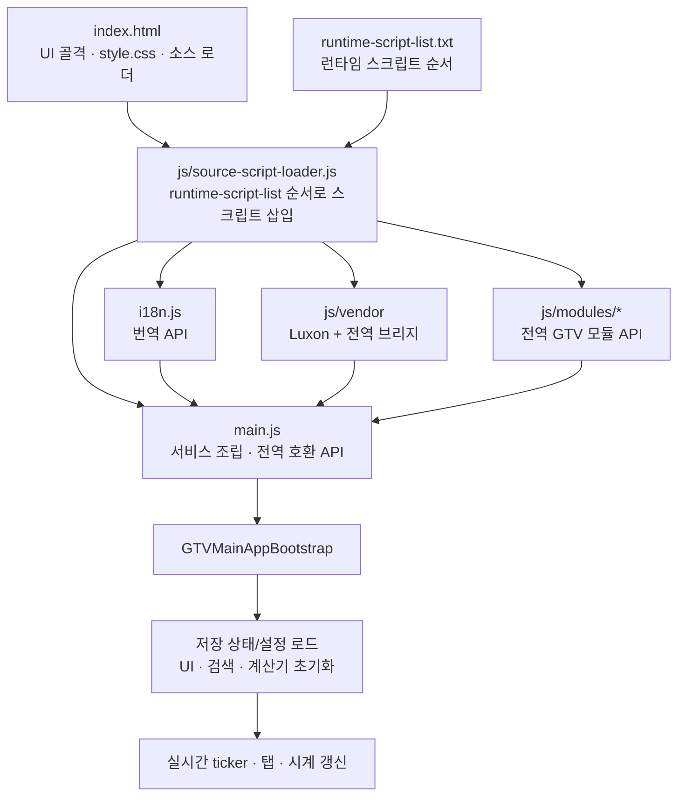
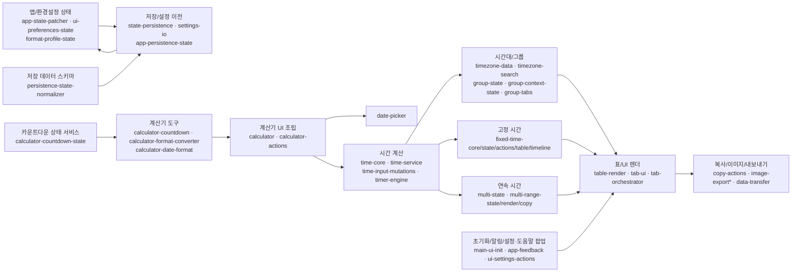

# Global Time Viewer 코드 구조 안내

> 기준: v3.17.1 소스 트리(6차 안정 버전). `src/runtime-script-list.txt`, `src/main.js`, `src/js/modules/main-module-spec.js` 및 각 서비스의 `createService(deps)` 배선을 기준으로 정리했습니다.

이 문서는 "어디에 무엇이 있는지"를 보여 주는 코드 지도입니다. 실행 흐름, `main.js` 조립 계층, 기능별 시작 파일, 기능별 구현 메모를 한곳에 모았습니다. 변경할 때 지킬 규칙과 검증·배포 절차는 [개발자 가이드](developer-guide.md), 모듈 파일별 전역 API·입력 의존성 키·반환 API·`main.js` 조립 호출 목록은 소스에서 생성하는 [의존성 인벤토리](module-dependency-inventory.md)(`npm run docs:module-inventory`), 프로그램 사용 방법은 [사용자 가이드](user-guide.md)를 참고하세요.

제품 코드는 모두 `src/` 아래에 있으며, 아래 경로는 특별한 표시가 없으면 `src/` 기준입니다(예: `main.js` = `src/main.js`, `js/modules/` = `src/js/modules/`). 모든 파일을 한 번에 읽기보다 아래 경계에 맞춰 관련된 부분만 따라갑니다.

## 목차

1. [실행 흐름](#1-실행-흐름)
2. [`main.js` 조립 계층](#2-mainjs-조립-계층)
3. [기능별 모듈과 시작 파일](#3-기능별-모듈과-시작-파일)
4. [기능별 구현 메모](#4-기능별-구현-메모)
5. [모듈 경계와 이 문서의 한계](#5-모듈-경계와-이-문서의-한계)

## 1. 실행 흐름

1. `index.html`은 DOM과 스타일을 준비하고 생성된 소스 로더(`js/source-script-loader.js`) 하나를 불러옵니다.
2. 로더는 `runtime-script-list.txt`의 런타임 스크립트를 `async = false`로 삽입해 선언 순서대로 실행합니다. 비동기 병렬 로드가 아니라 전역 등록 순서가 의미 있는 로드입니다.
3. 설정, 번역, vendor, 모듈 API가 등록됩니다. 각 모듈은 보통 `window.GTV...` 또는 호스트 전역 객체에 API를 등록합니다.
4. 목록 끝의 `main.js`가 `main-module-spec.js`와 `main-module-resolver.js`로 필요한 모듈 API가 준비되었는지 확인하고, 상태 접근자 → 핵심 서비스 → 도메인 서비스 → UI·저장 서비스를 순서대로 조립합니다.
5. `GTVMainAppBootstrap`(`main-app-bootstrap.js`)이 초기화 순서를 진행하고 성공 후 상호작용·시계 갱신을 시작합니다. 필수 초기화 실패 시 사용자용 오류 화면이 표시됩니다.

배포 빌드는 같은 순서 목록을 하나의 축약 번들(`js/bundle.js`)로 합쳐 생성 로더 대신 사용합니다. 런타임 파일을 추가·이동할 때의 절차는 [개발자 가이드 2장](developer-guide.md#2-런타임-흐름과-로드-순서)을 따릅니다.

## 2. `main.js` 조립 계층

모듈은 ES `import`로 연결되지 않습니다. 각 파일이 `window`/`globalThis`에 `GTV...` API를 등록하고, `main.js`가 `main-module-spec.js`의 명세와 `main-module-resolver.js`로 모듈을 확인한 뒤 `createService(deps)`에 의존성을 전달합니다.

```mermaid
flowchart LR
    SPEC["main-module-spec\n전역 이름 · 필수 API · 선택 모듈"] --> RESOLVE["main-module-resolver\nAPI 존재/형태 검사"]
    RESOLVE --> MAIN["main.js\n의존성 조립 · 전역 API 호환 셸"]
    STATE["상태/호스트 준비\nstate vars · host · primary state"] --> CORE["핵심 서비스 조립\ncore assembly · foundation · helpers"]
    MAIN --> SPEC
    MAIN --> STATE
    STATE --> CORE
    CORE --> DOMAIN["도메인 서비스\ntimezone · fixed time · multi-range\n시간 조정 · 그룹 · persistence"]
    DOMAIN --> UI["UI/렌더 서비스\ntable · timeline · tabs · image export"]
    CORE --> COMPOSE["composition bootstrap\n도메인 설정/서비스 조립"]
    DOMAIN --> COMPOSE
    UI --> COMPOSE
    COMPOSE --> WIRE["runtime bootstrap wiring"]
    WIRE --> PUBLIC["runtime public API bindings"]
    PUBLIC --> APP["main-app-bootstrap\n초기화 순서 실행"]
```

| 단계 | 모듈 | 역할 |
| --- | --- | --- |
| 명세와 검사 | `main-module-spec.js`, `main-module-resolver.js`(`main.js`가 직접 호출) | 전역 API 이름, 필수 `createService`, 선택 모듈 및 데이터 형식 검증 |
| 전역 이름 연결 | `main-global-bindings.js` | `main.js`가 쓰는 모듈 전역 이름 목록(`BINDING_MAP`) |
| 기본 상태/호스트 | `main-state-initializer.js`, `main-runtime-host-utils.js`, `main-runtime-primary-state.js`, `main-runtime-local-state-helpers.js` | 브라우저 API와 앱 기본 상태를 서비스로 제공. state-core bootstrap이 만들고 함수를 그대로 내보냄 |
| 핵심/상태 조립 | `main-runtime-state-core-bootstrap.js`, `main-runtime-core-assembly-bootstrap.js`, `main-runtime-core-foundation-bootstrap.js`, `main-runtime-state-helper-bootstrap.js`, `main-runtime-core-service-bootstrap.js` | 상태 접근, 공통 서비스, 핵심 의존성 조립. state-helper bootstrap은 `main-runtime-state-helpers` 서비스의 함수 20개를 그대로 내보냄 |
| 늦게 정해지는 참조 | `main-runtime-reference-accessors.js` | 조립 중 나중에 만들어지는 서비스·상태를 읽는 함수 80개(대부분 표 `PASS_THROUGH_REFS` 하나로 정의, 로직이 있는 함수 8개) |
| UI/도메인 서비스 조립 | `main-runtime-table-image-bootstrap.js`, `main-runtime-domain-service-bootstrap.js`, `main-runtime-ui-services-bootstrap.js`, `main-runtime-persistence-composition-bootstrap.js`, `main-runtime-composition-bootstrap.js` | 표/이미지, 도메인, 저장, 화면 관련 서비스를 구성 |
| 외부 연결 | `main-runtime-bootstrap-wiring.js`, `main-runtime-public-api-bindings.js`, `main-app-bootstrap.js` | UI·작업·부트스트랩 호출 연결, 앱 시작 순서 실행 |

조립에서 반복되는 일은 공용 도우미가 맡습니다.

| 하는 일 | 위치 |
| --- | --- |
| 모듈 API 확인 후 서비스 생성, 필수 메서드 검사 | `GTVServiceInvokeUtils.createRequiredModuleService` |
| 나중에 만들어지는 서비스를 호출할 때 찾아 부르기 | `GTVServiceInvokeUtils.createLateBoundForwarders`(host 접근 함수, patched state 접근 함수, direct state patch) |
| state-domain 함수·표시 형식 함수를 전역 객체에 올리기 | `main.js`의 `exposeOnGlobalHost` |
| 앞쪽 조립 코드에 미리 넘기는 공개 호환 함수 | `main.js` 끝의 `Public compatibility facade`(인수 기본값은 `main-runtime-public-api-bindings`가 적용) |

남은 accessor proxy 4개(`main-runtime-bootstrap-accessor-proxies`, `-core-`, `-operation-`, `-ui-bridge-`)는 단순 전달이 아니라 인수 정리, 기본값, 없는 기능 알림 같은 동작을 가집니다.

### `main.js`에서 찾을 위치

`main.js`는 조립 단계들을 직접 호출하고, 상태 변수를 클로저로 보유하며, 다수의 호환 전역 함수를 공개합니다. 기능 계산이나 UI 동작을 구현하는 곳이 아니므로 주요 변경 위험 지점은 순수 기능 모듈보다 이 파일의 배선과 전역 호환 경계입니다.

| 수정 목적 | 검색할 식별자 또는 주석 | 책임 |
| --- | --- | --- |
| 필수 모듈 계약 확인 | `assertRequiredServices` | 모듈 API 누락을 초기 단계에서 검출 |
| 상태 접근자와 공용 서비스 조립 | `mainRuntimeCoreAccessorService`, `mainRuntimeCoreFoundationServices` | 상태와 핵심 서비스 연결 |
| 공용 계산·상태 도우미 | `Shared Core Utilities`, `Group Data Structures` | 여러 서비스가 공유하는 호스트·그룹 유틸리티 준비 |
| 표·이미지 기능 조립 | `mainRuntimeTableImageServices` | 표 표시와 이미지 내보내기 계열 서비스 연결 |
| 도메인 기능 조립 | `mainRuntimeDomainServices` | 시간대, 고정 시간, 다중 범위 등 연결 |
| 저장·앱 구성 | `mainPersistenceCompositionServices`, `mainRuntimeCompositionServices` | 영속성 및 사용자 기능 서비스 조합 |
| 초기화 순서와 브리지 연결 | `mainRuntimeBootstrapWiringServices` | 공개 서비스와 앱 시작 절차 연결 |
| 이전 전역 함수 호출 경로 | `callMainRuntimePublicApi`, `Public compatibility facade` | 호환 전역 호출을 공개 서비스로 전달 |
| 전역 객체에 올리는 호환 함수 | `exposeOnGlobalHost` | state-domain 함수와 표시 형식 함수를 `window`에 복사 |
| 나중에 만들어지는 서비스 호출 | `createLateBoundForwarders`, `createRequiredModuleService` | 서비스 생성·확인과 늦은 호출 연결 |

새 기능은 도메인 서비스에 구현하고, 이 파일에는 필요한 의존성 전달과 공개 함수 연결만 추가합니다. 기존 조립 단계를 통째로 바꾸기보다 영향을 받는 단계와 그 단계의 모듈 테스트를 함께 확인합니다.

## 3. 기능별 모듈과 시작 파일

화살표는 대표적인 서비스 데이터 흐름입니다. 실제 구체 의존성은 `main.js`의 설정 객체와 각 조립 모듈을 통해 전달됩니다.

| 기능 영역 | 시작점 | 함께 볼 파일 | 경계에서 확인할 것 |
| --- | --- | --- | --- |
| 시간 계산·시간 입력 변경 | `time-service.js` | `time-core.js`, `time-input-mutations.js`, `timer-engine.js` | 시간대 변환·날짜 산술과 DOM 이벤트를 섞지 말고 기존 반환 데이터와 날짜 경계 의미를 유지합니다. |
| 시간대 검색·표시 데이터 | `timezone-data.js` | `timezone-search.js` | 지역 식별자, 검색 결과, 사용자 지정 고정 오프셋의 의미를 보존합니다. |
| 그룹·탭 상태 | `group-state.js` | `group-context-state.js`, `group-tabs.js`, `app-state-patcher.js`, `app-persistence-state.js`, `ui-preferences-state.js`, `format-profile-state.js` | 현재 그룹·보조 그룹과 도메인 데이터 간 단일 소유 흐름을 유지합니다. |
| 실시간 표·복사·이미지 | `table-render.js` | `table-image-render.js`, `copy-actions.js`, `image-export.js`, `image-export-actions.js`, `image-export-bridge.js`, `image-export-naming.js`, `image-clone.js`, `image-foreign-render.js` | 표시 데이터와 이미지용 복제·렌더 경로를 혼동하지 말고 현재 UI 상태를 기준으로 합니다. |
| 고정 시간·타임라인 | `fixed-time-state.js` | `fixed-time-core.js`, `fixed-time-slot-utils.js`, `fixed-time-actions.js`, `fixed-time-table.js`, `fixed-time-timeline.js`, `timeline-frame.js` | 고정 날짜, 슬롯 상태, 표시 여부가 같이 움직이는 경로를 추적합니다. |
| 연속 시간 변경 | `multi-state.js` | `multi-range-state.js`, `multi-range-render.js`, `multi-range-copy.js`, `multi-range-image-render.js`, `multi-bulk-tools.js` | 그룹·보조 그룹별 범위, 개수, 편집 옵션을 함께 유지합니다. |
| 계산기·날짜 입력 | `calculator.js`(단위 변환·기간/날짜 이동·조립) | `calculator-date-format.js`(날짜 파싱·형식), `calculator-countdown.js`, `calculator-countdown-state.js`(상태 정규화·표시), `calculator-format-converter.js`(시간 포맷 변환기), `calculator-actions.js`, `date-picker.js`, `time-adjust-ui.js`, `time-adjust-actions.js` | 계산 결과 의미를 바꾸지 않고 DOM 입력 검증·피드백과 핵심 연산을 구분합니다. |
| 저장 데이터 정규화 | `persistence-state-normalizer.js` | `state-persistence.js`, `format-profile-state.js`, `multi-state.js` | 들어오는 데이터의 기본값·형태 정규화를 맡습니다. |
| 브라우저 저장소(`localStorage`)·설정 이동 | `state-persistence.js` | `persistence-service-bundle.js`, `settings-io.js`, `data-transfer.js` | `localStorage` 읽기·쓰기와 앱 상태 복구를 맡습니다(확장에 `storage` 권한이 없어 `chrome.storage`는 쓰지 않음). 공개 진입점은 `GTVStatePersistence.createService()`입니다. 정규화, 구버전 읽기, 전체·그룹·보조 그룹 payload는 서로 다른 책임입니다. |
| 타임존 추가 팝업(타임존 프리셋·사용자 커스텀 탭) | `timezone-search.js`(`openFullTimezoneOverlay`, `setFullTimezoneOverlayTab`) | `index.html`의 `#full-tz-overlay`·`#tz-custom-panel`, `main-ui-init.js`(커스텀 추가 처리), `main-timezone-mutation-services.js`(중복 검사) | 4장 메모 참고 |
| 설정·도움말 팝업 | `ui-settings-actions.js`(`bindDialogControls`) | `index.html`의 `#settings-overlay`·`#help-overlay`, `i18n.js`의 `settings_*`·`help_*` 키, `main-ui-init.js`(연결), `format-controls.js` | 4장 메모 참고 |
| 그룹 설정 팝업(이름·내보내기/가져오기·기준 시간·낮/밤·삭제) | `group-tabs.js`(`openGroupSettings`) | `index.html`의 `#group-settings-overlay`, `i18n.js`의 `group_settings_*` 키, `ui-preferences-state.js`(그룹별 낮/밤), `main-ui-init.js`(`gtv:group-settings-opened`로 낮/밤 선택값 동기화) | 4장 메모 참고 |
| 초기화·알림 | `main-ui-init.js` | `app-feedback.js`, `main-foundation-services.js`(화면 안 입력·확인 창) | |
| 화면 스타일 | `style.css` | 맨 위 목차에서 `§번호`로 구역을 찾음(테마 변수, 컨트롤 패널, 시간 표, 타임라인, 계산기, 모달, DatePicker 등) | 구역 규칙은 개발자 가이드 6장 |
| 핵심·표·이미지 서비스 의존성 구성 | `main-runtime-core-service-bootstrap.js`, `main-runtime-table-image-bootstrap.js` | 각 조립부가 생성할 서비스의 설정 | |
| 도메인 서비스 조립·의존성 구성 | `main-runtime-domain-service-bootstrap.js`, `main-runtime-ui-services-bootstrap.js` | 도메인 서비스를 만드는 데 필요한 설정과 생성 순서 | |
| 최종 앱 시작 wiring | `main-runtime-bootstrap-wiring.js` | 앱 bootstrap 설정과 공개 API 연결 | |
| 모듈 필수 API 계약 | `main-module-spec.js` | `main-module-resolver.js`, `module-create-service-convention.test.mjs` | |

이 표는 탐색용 요약입니다. 정확한 파일별 전역 API·입력 계약은 생성 인벤토리를 기준으로 합니다.

## 4. 기능별 구현 메모

화면 기능 중 여러 모듈이 함께 움직이거나 예전 데이터와의 호환이 걸린 부분의 현재 구현입니다.

### 시간대 데이터와 서머타임

- 시간대 항목은 불러오거나 가져올 때 `group-state.js`가 정리합니다. 도시 시간대(IANA)에 그 도시의 1월 또는 7월 시차와 같은 고정 시차가 남아 있으면(v3.11.1 이전 국가-지역 목록이 저장한 "PDT 고정" 같은 항목) 고정 시차를 지워 서머타임 규칙을 따르게 합니다. 두 계절 어느 쪽과도 다른 고정 시차는 그대로 둡니다.
- 서머타임 표시는 시각마다 판단합니다. 판단은 `GTVTimeCore.isZoneInDaylightTime`(그 시각의 시차가 그 해 1월·7월 중 작은 시차보다 크면 서머타임)으로 하고, 사용자 지정·`UTC`·고정 시차 항목은 표시하지 않습니다. 표(`table-render`·`main-row-view-services`·`multi-range-render`)는 `snapshot.dstFlags`로, 고정 시간 탭은 payload의 `isDst`로 `.dst-badge`를 보이거나 숨기고, 텍스트 복사(`snapshot-format`·`fixed-time-actions`)와 이미지(`table-image-render`·`image-clone`)도 같은 값을 씁니다. 표시 여부는 시간 세부 항목 `dst`(기본 켜짐)로 정합니다.
- 시각을 입력하면(`time-input-mutations.js`) 그 지역의 시차를 실제 순간에서 다시 확인합니다. 서머타임 시작으로 건너뛰는 시각은 건너뛴 만큼 뒤로 맞추고 `toast_dst_gap_adjusted`로 알리며, 서머타임 종료로 두 번 있는 시각은 첫 번째(서머타임 쪽)로 해석합니다. 고정 시간 표 칸은 시 0~23·분·초 0~59와 실제 날짜를 검사해 범위 밖이면 거부합니다.

### 타임존 추가 팝업

- 시간대 추가는 `타임존 추가` 팝업(`#full-tz-overlay`) 하나로 합니다. 본 화면에는 도구 줄(`#control-option-row`) 맨 앞에 `타임존 추가` 이름표와 `목록` 버튼(`#show-all-tz`)만 있습니다.
- 팝업은 `timezone-search.js`가 맡고 탭은 `타임존 프리셋`(`tz-tab-country`, 먼저 열림)과 `사용자 커스텀`(`tz-tab-custom`) 두 개입니다(`setFullTimezoneOverlayTab`).
- 타임존 프리셋의 첫 타일 `표준시 (UTC)`(`utc-row` 항목)는 별도 시간대를 만들지 않고 표의 UTC 행을 다시 켭니다(이미 보이면 중복 안내). 나머지 타일은 도시 목록이며 도시·약어·UTC 오프셋으로 검색합니다.
- 사용자 커스텀 탭은 검색칸과 목록 대신 입력 양식(`#tz-custom-panel`)을 보입니다. 입력칸 id(`custom-abbr` 등)는 예전과 같아 `main-ui-init.js`의 추가 처리기가 그대로 동작하고, 추가에 성공하면 닫기 버튼으로 팝업을 닫습니다.
- 팝업을 닫는 길(닫기 버튼, 목록 항목 선택, 커스텀 추가 성공, Esc)은 모두 `closeFullTimezoneOverlay`를 거칩니다. 이때 커스텀 양식을 비우고 시차를 +00:00으로 되돌리고 초점을 `목록` 버튼으로 돌려줍니다(강조 없이). Esc는 화면 안 입력·확인 창이 위에 떠 있으면 그 창이 먼저 받습니다.
- 표를 다시 그리는 `renderList`(`main-timezone-table-facade.js`)는 실시간·시간 변경 탭에서는 표 렌더러가 `updateClocks`로 타임라인과 복사 미리보기까지 갱신합니다. 고정 시간 탭에서는 고정 시간 표만 그리므로 `renderList`가 이어서 타임라인(`renderTimelineFrame`)을 다시 그립니다. `실시간 표시`가 꺼져 있으면 1초마다 다시 그리는 일이 없어서, 이렇게 하지 않으면 UTC 타일로 다시 켠 행이 타임라인에 바로 나오지 않습니다. 복사 미리보기는 모든 탭에서 기준 시간 한 줄만 보여 주는 형식 예시라 행을 더하거나 빼도 바뀌지 않습니다.
- 고정 시차 항목은 사용자 지정(custom) 항목입니다(`offH`/`offM`). 예전 `표준시 목록` 탭이 내부 시간대 `UTC`+고정 시차로 저장한 항목은 `group-state.js`가 불러올 때 같은 id의 사용자 지정 항목(약어 `UTC+09:00`, 이름 `UTC+09:00 표준시`; `time-core.js`의 `toCustomOffsetFields`)으로 바꾸고(시차 0은 UTC 행으로 합침), 이름 끝의 `표준시`/`Standard Time`은 화면 언어를 따릅니다(`getZoneDisplayName`). 내부 시간대 `UTC`는 모든 화면에서 UTC 행으로 다뤄지므로 표준 항목에 쓰지 않습니다.

### 팝업·확인 창·툴팁

- 그룹 설정 팝업(`#group-settings-overlay`)은 선택한 그룹 탭의 설정 버튼(`.group-settings-btn`)으로 열고 `group-tabs.js`의 `openGroupSettings`·`closeGroupSettings`가 열기·닫기(닫기 버튼, 바깥 클릭, Esc, 초점 복귀)를 맡습니다. 이름은 `변경` 버튼(`#group-settings-name-apply-btn`)을 눌렀을 때만 저장하고, 닫기로는 저장하지 않습니다. 기준 시간·낮/밤 선택칸은 예전과 같은 id(`base-time-select`, `day-start-select`, `night-start-select`)로 이 팝업 안에 있어 기존 처리기가 그대로 동작합니다. 팝업을 열면 `gtv:group-settings-opened` 문서 이벤트를 보내고, `main-ui-init.js`가 이를 받아 낮/밤 선택값을 현재 그룹 값으로 다시 맞춥니다.
- 낮/밤 시간은 그룹의 선택 필드 `dayStartHour`·`nightStartHour`(0 ≤ 낮 < 밤 ≤ 23인 정수일 때만 유지, `group-state.js` 정규화)에 저장합니다. `ui-preferences-state.js`는 현재 그룹에 값이 있으면 그 값을, 없으면 공통 상태 값을 쓰고, 바꿀 때는 현재 그룹에 씁니다. 그룹 내보내기에는 그룹 값을, 전체 설정 내보내기의 환경설정에는 공통 값을 넣으므로 옛 파일도 그대로 가져올 수 있습니다.
- 설정 팝업(`#settings-overlay`)과 도움말 팝업(`#help-overlay`)은 사이드바 아이콘(`#open-settings-btn`, `#open-help-btn`)으로 열고 `ui-settings-actions.js`의 `bindDialogControls`가 열기·닫기(닫기 버튼, 바깥 클릭, Esc, 초점 복귀)를 맡습니다. 초기화가 확인되거나(초기화 함수가 `true`) 설정 가져오기가 성공하면(`handleSettingsImportFile`이 `true`) 설정 팝업을 닫습니다. 설정 팝업 안의 선택칸·버튼은 예전 사이드바와 같은 id를 써서 기존 처리기가 그대로 동작합니다. 도움말 문구는 `i18n.js`의 `help_*` 키입니다.
- 확인 창은 `main-foundation-services.js`의 `confirmFn`이 화면 안 확인 창(`#app-confirm-overlay`)으로 묻고 `true`/`false`를 돌려주는 비동기 함수입니다(취소에 첫 초점, 닫기 버튼·바깥 클릭·Esc는 취소). 표시용 요소가 없을 때만 주입된 브라우저 확인으로 대신합니다. 초기화(`state-persistence.js`)와 그룹·보조 그룹 삭제(`group-tabs.js`)가 결과를 기다립니다.
- 툴팁은 `main-ui-utils.js`의 떠 있는 툴팁(`#app-floating-tooltip`)이 `data-tooltip` 요소에 마우스를 올리거나 초점이 오면 보입니다. 초점으로 띄우는 것은 Tab 키로 이동했을 때뿐이라서(직전 입력이 Tab 키일 때), 팝업이 닫히며 버튼으로 돌려준 초점이나 클릭으로 생긴 초점은 툴팁을 띄우지 않습니다.
- 팝업은 닫힐 때 초점을 연 버튼(또는 이전 요소)으로 `focus({ focusVisible: false, preventScroll: true })`로 돌려줘, Esc로 닫아도 키보드 초점 강조(`:focus-visible`)가 남지 않습니다(그룹 설정 `group-tabs.js`, 설정·도움말 `ui-settings-actions.js`, 화면 안 입력·확인 창 `main-foundation-services.js`).

### 도구 줄·계산기·시간 조정 배치

- 도구 줄 안의 구분선은 묶음 경계(`option-with-divider`, `::before`)와 묶음 안의 짧은 세로선(`.control-inline-divider`, 시간 조정 줄 구분선과 같은 모양)으로 그립니다. 고정 날짜 묶음은 날짜 선택 버튼 뒤에 `.control-inline-divider`를 두고 `실시간 표시` 이름표에 다른 이름표와 같은 `.control-label-large`를 씁니다.
- 계산기의 날짜 칸(`.calc-date-input-wrap`)은 입력칸과 달력 버튼을 한 줄에 두고 오류 문구만 아래 줄로 보냅니다. 기간 계산은 시작일·종료일을 각각 라벨과 함께 `.calc-period-field`로 묶어 바꾸기 버튼과 한 줄(flex 줄바꿈)에 놓고, 한 칸이 날짜를 다 보여 줄 최소 너비(140px)보다 좁아지면 종료일이 다음 줄로 내려갑니다. 바꾸기 버튼은 라벨 높이만큼 내려 입력칸 줄에 맞춥니다. 날짜 이동의 단위·방향 선택칸은 `.calc-shift-selects`로 묶여 각자 최소 너비(`--calc-select-min`, 한국어 76px·영어 100px)를 지키고, 숫자 칸 옆에 자리가 모자라면 함께 다음 줄로 내려갑니다.
- 시간 조정 줄은 앞쪽 버튼(지금 시간·0시·정각, 기간 0일로 변경, 이전 구간 끝 가져오기)을 고정 폭 칸 `.time-adjust-lead`에 넣어 줄마다 뒤의 버튼 열이 같은 위치에 서게 합니다. 화면에서 너비를 재서 맞추는 코드는 두지 않습니다.

## 5. 모듈 경계와 이 문서의 한계

- `js/modules/`에는 기능 모듈(약 58개)과 `main-*` 조립 모듈(86개)이 함께 있습니다. `main-*`에는 bootstrap, config builder, facade, 서비스 묶음, 남은 accessor proxy와 `*-bindings`가 있습니다. 이름이 비슷해도 기본값·대체 처리·여러 서비스 조합 같은 동작을 가진 경우가 있으므로, 내용과 테스트를 확인하기 전에는 중복 모듈로 간주하지 않습니다.
- 공통 도메인 서비스는 대체로 `createService(deps)` 형태이고 의존성을 명시적으로 전달합니다. `main.js`는 레거시 호환과 전역 상태 연결을 담당하므로 새 도메인 로직은 기능 모듈에 두고 조립부에서 연결합니다.
- 이 문서의 관계도는 현재 소스의 로더 순서와 조립 계층을 요약한 것입니다. 모듈 간 모든 개별 메서드 호출이나 상태 읽기·쓰기를 자동 추출한 그래프가 아니므로, 세부 관계를 바꿀 때는 해당 `createService` 호출부와 모듈 테스트를 함께 추적합니다.
